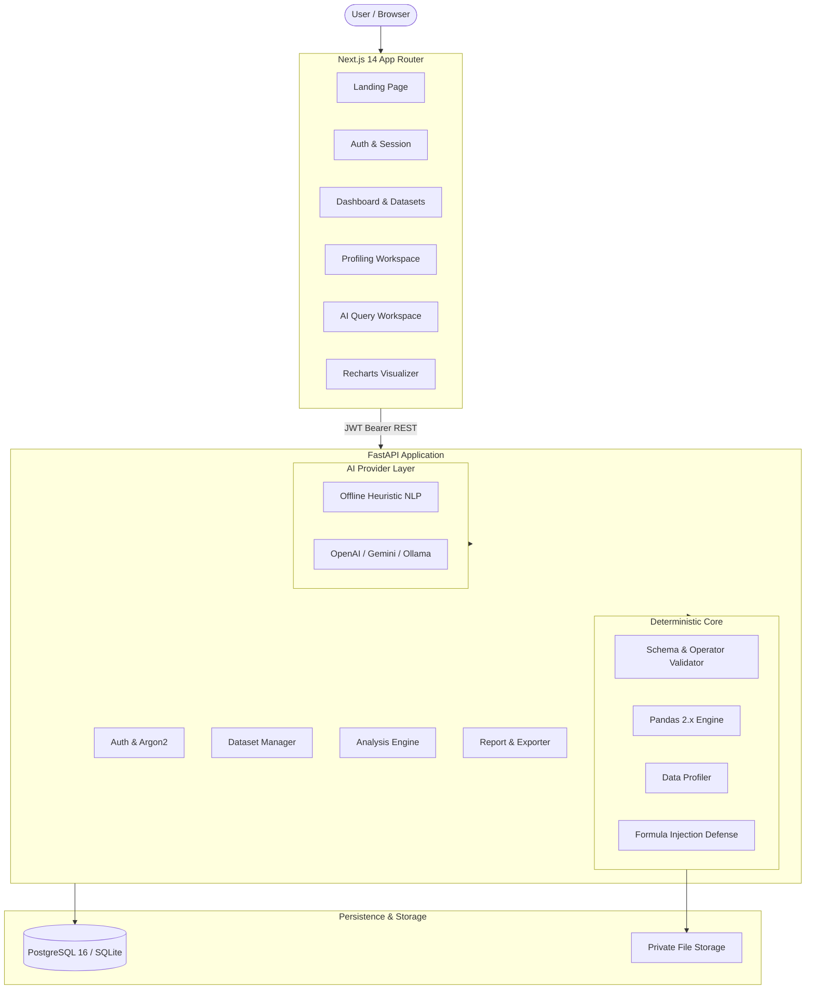

# QueryPilot — AI Data Analyst Workspace

[](file:///d:/query/backend/tests)
[](https://www.python.org/)
[](https://fastapi.tiangolo.com/)
[](https://nextjs.org/)
[](https://tailwindcss.com/)
[](https://www.argon2.org/)

QueryPilot is a full-stack, enterprise-grade data analysis workspace that enables users to upload CSV files, automatically profile datasets, query data using natural language, execute deterministic analytical operations in pandas, render interactive visualizations, and export formula-safe reports.

Unlike superficial AI demo tools, QueryPilot **never hallucinates or fabricates numbers**. Natural language questions are translated into structured, schema-validated execution plans that run strictly on pandas. If an external LLM is not configured, QueryPilot's deterministic heuristic engine seamlessly handles analytical questions offline with zero paid API dependencies.

---

## Architecture Overview



---

## Key Features

1. **Enterprise Authentication & Security**
   - User registration and login protected with **Argon2id** password hashing.
   - 24-hour JWT bearer session management.
   - Resource-level authorization: users cannot access or delete other users' datasets or reports.
   - Formula injection protection (DDE defense) prepending escape characters on exported CSVs.

2. **Automated Data Profiling**
   - Automatically computes row and column counts, memory usage, and duplicate rows.
   - Type inference: Integer, Float, String, Boolean, DateTime.
   - Missing-value percentages with visual progress indicators.
   - Numeric summary metrics: Mean, Standard Deviation, Min, 25%, Median, 75%, and Max.
   - Categorical distribution frequencies for top values.

3. **Deterministic Analytical Engine**
   - Strict input validation against dataset schema.
   - Supported operations: `group_by`, `aggregate` (sum, mean, median, min, max, count, nunique, std), `filter` (with allowlisted operators `eq`, `gt`, `lt`, `gte`, `lte`, `contains`, `in`, `is_null`), `sort`, `correlation`, `describe`, and `top_k`.
   - **Zero code execution risk**: No `eval()`, `exec()`, or raw SQL.

4. **Hybrid AI Architecture with Offline Fallback**
   - Dual-mode architecture: External LLM integration for enhanced natural language translation and an offline deterministic heuristic parser.
   - Runs 100% out of the box with zero external API keys required.

5. **Dynamic Data Visualizations**
   - Recharts-powered interactive charts: Bar Chart, Line Chart, Pie Chart, and Data Tables.
   - Live chart switcher to view different visual representations of verified queries.

6. **Formula-Safe Reports and Exports**
   - Export analysis results to CSV with automatic spreadsheet formula sanitization.
   - Persisted report history with secure download endpoints.

---

## Project Structure

```
querypilot/
├── backend/
│   ├── app/
│   │   ├── ai/            # Provider abstraction & offline heuristic NLP
│   │   ├── analytics/     # Pure pandas engine, data profiler & CSV exporter
│   │   ├── api/           # Versioned REST API routes (/auth, /datasets, /analyses, /reports)
│   │   ├── core/          # Settings, security & Argon2 hasher
│   │   ├── db/            # SQLAlchemy 2.0 session & database engine
│   │   ├── models/        # SQLAlchemy ORM models (User, Dataset, Analysis, Report)
│   │   ├── schemas/       # Pydantic v2 schemas for requests & responses
│   │   ├── storage/       # File storage abstraction & path safety checks
│   │   └── main.py        # FastAPI entrypoint, CORS, and exception handlers
│   ├── migrations/        # Alembic database migrations
│   ├── tests/             # Automated test suite (15 unit, integration & E2E tests)
│   ├── Dockerfile         # Production backend container definition
│   └── requirements.txt   # Python dependencies
├── frontend/
│   ├── app/               # Next.js 14 App Router pages
│   │   ├── dashboard/     # Workspace, Datasets, Profiler, History, Reports, Settings
│   │   ├── login/         # Sign in with demo prefill
│   │   ├── register/      # Account registration
│   │   └── page.tsx       # Landing page
│   ├── components/        # Reusable UI components (Navbar, Sidebar)
│   ├── lib/               # Centralized typed API client
│   ├── types/             # TypeScript interfaces
│   ├── Dockerfile         # Production multi-stage frontend container
│   └── package.json       # Node dependencies
├── docker-compose.yml     # Multi-container orchestration (PostgreSQL, Backend, Frontend)
├── .env.example           # Environment template
└── README.md              # Project documentation
```

---

## Local Setup & Quickstart

### Prerequisites
- Python 3.10+
- Node.js 18+ (Node 20+ recommended)
- Git

### 1. Clone & Configure Environment
```bash
git clone https://github.com/your-username/querypilot.git
cd querypilot
cp .env.example .env
```

### 2. Backend Setup
```bash
# Create and activate virtual environment
python -m venv backend/venv
# Windows:
backend\venv\Scripts\activate
# Linux/macOS:
# source backend/venv/bin/activate

# Install dependencies
pip install -r backend/requirements.txt

# Run migrations
alembic upgrade head

# Start FastAPI server
uvicorn app.main:app --host 0.0.0.0 --port 8000 --reload
```
API Documentation will be accessible at: `http://localhost:8000/api/v1/docs`

### 3. Frontend Setup
```bash
cd frontend
npm install
npm run dev
```
Frontend workspace will be accessible at: `http://localhost:3000`

---

## Running Automated Tests

QueryPilot comes with a comprehensive pytest test suite covering authentication, dataset validation, ownership access control, pandas analytical computations, CSV formula sanitization, and the end-to-end user workflow:

```bash
backend\venv\Scripts\pytest backend\tests -v
```

Output:
```
============================= test session starts =============================
backend/tests/test_analytics.py::test_aggregation_without_groupby PASSED
backend/tests/test_analytics.py::test_groupby_aggregation_with_sort PASSED
backend/tests/test_analytics.py::test_filters PASSED
backend/tests/test_analytics.py::test_unknown_column_rejected PASSED
backend/tests/test_analytics.py::test_numeric_agg_on_string_column_rejected PASSED
backend/tests/test_auth.py::test_password_hashing PASSED
backend/tests/test_auth.py::test_user_registration_and_login PASSED
backend/tests/test_datasets.py::test_csv_upload_and_profiling PASSED
backend/tests/test_datasets.py::test_invalid_csv_uploads PASSED
backend/tests/test_datasets.py::test_dataset_ownership_authorization PASSED
backend/tests/test_e2e.py::test_full_end_to_end_analysis_workflow PASSED
backend/tests/test_exporter.py::test_csv_formula_injection_sanitization PASSED
backend/tests/test_exporter.py::test_csv_export_format PASSED
backend/tests/test_health.py::test_health_endpoint PASSED
backend/tests/test_health.py::test_root_endpoint PASSED
======================= 15 passed in 0.92s ========================
```

---

## Docker Deployment

To launch the full production stack (PostgreSQL 16, FastAPI backend, and Next.js frontend) with one command:

```bash
docker compose up --build -d
```

- **Frontend**: `http://localhost:3000`
- **Backend API**: `http://localhost:8000`
- **PostgreSQL**: `localhost:5432`

---

## Resume Description

> **QueryPilot — AI-Powered Data Analyst Workspace** *(Python, FastAPI, Next.js, TypeScript, PostgreSQL, SQLAlchemy, pandas, Recharts, Docker)*
> - Engineered a full-stack data analytics platform enabling users to upload CSVs, automatically compute column statistics, and query datasets in natural language.
> - Implemented a safe, deterministic pandas execution engine with strict schema allowlists, eliminating code execution risks (`eval`/raw SQL) and AI hallucinations.
> - Built automated data profiling calculating missing-value percentages, duplicate rows, data types, and descriptive statistics across datasets.
> - Developed responsive data visualizations with Recharts (Bar, Line, Pie, and Tables) and implemented formula-injection (DDE) defenses for CSV exports.
> - Authored an automated test suite with pytest covering auth, dataset ownership, analytical operations, and end-to-end user flows.
